# Optimization of BP Neural Networks with Subtraction Optimizer Algorithm Integrated with Golden Section Sine - Both Regression and Classification Cases

Today, we employ the most successful intelligent optimization algorithm recently improved - the Gold-Sine Algorithm for Subtraction Optimizer (GSABO) to optimize the Backpropagation Neural Network (BPNN). This algorithm is not only the newest in 2023 but also shows excellent convergence speed and optimization precision after improvements! Click the link to jump to the GSABO algorithm: Merge Gold-Sine, ten chaos maps, done! Achieve optimal values every time. The approach in this article can be applied to the improvement of all intelligent algorithms.
The article discusses two cases, regression and classification. In the regression case, an example of classic stock data is used. In the classification case, a common UCI dataset is chosen.
Initial weights and thresholds of the BP neural network are randomly generated, so they may not necessarily be optimal. By using intelligent algorithms to optimize the weights and thresholds of the BP neural network, it allows for a more perfect mapping relationship between input and output, thereby enhancing the accuracy of the BP neural network model. This article uses the GSABO algorithm to optimize the weights and thresholds of the BP neural network and applies it to actual regression and classification cases.
01 Stock Forecasting Case
Although the case is about stock forecasting, the GSABO-BP prediction model is universal, and you can directly replace your own data.
Standard BP model prediction results:
It can be seen that the standard BP neural network's prediction effect is not very ideal, unable to track real values, with large deviations.
GSABO-BP prediction results:
It can be seen that the GSABO-BP neural network's prediction values closely follow the real values, showing good results.
Putting together the true values, BP prediction values, and GSABO-BP prediction values makes the effect even more evident.
Next is a comparison chart of the error between the GSABO-optimized and unoptimized BP neural networks.
GSABO-BP's iterative curve, with the MSE as the objective function for prediction values and true values.
02 Classification Case
Next is the classification case of the GSABO-BP, using the Balancescale.mat data from the UCI dataset, which is divided into three categories. Let's see the results.
Standard BP model classification results:
Confusion matrix result graph:
To understand this graph, please look at it horizontally. The sum of each row's data equals 100%, and the sum of the number of data points in each row corresponds to the actual number of first-class data in the test set. Taking the first row as an example, there are 12 data points in the test set that belong to the first class, among which 8 are correctly predicted, 1 is misclassified into the second class, and 3 are misclassified into the third class. This interpretation applies to all other rows.
The following graph is another way of presenting results, which is sometimes used in papers.
GSABO-BP classification results:
03 Code display

## Images

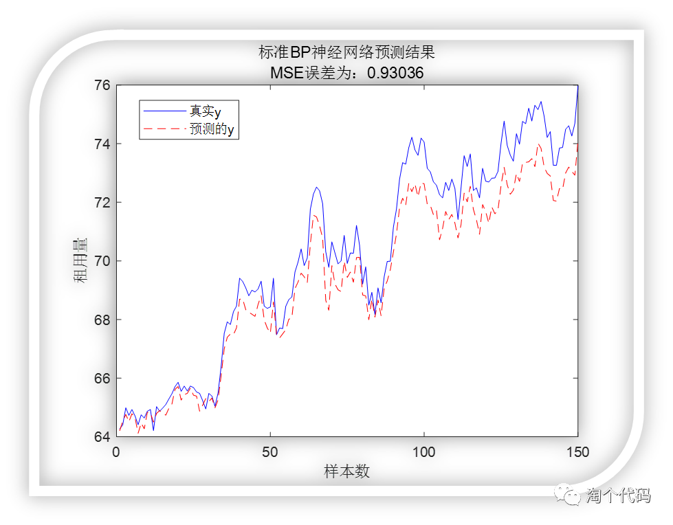
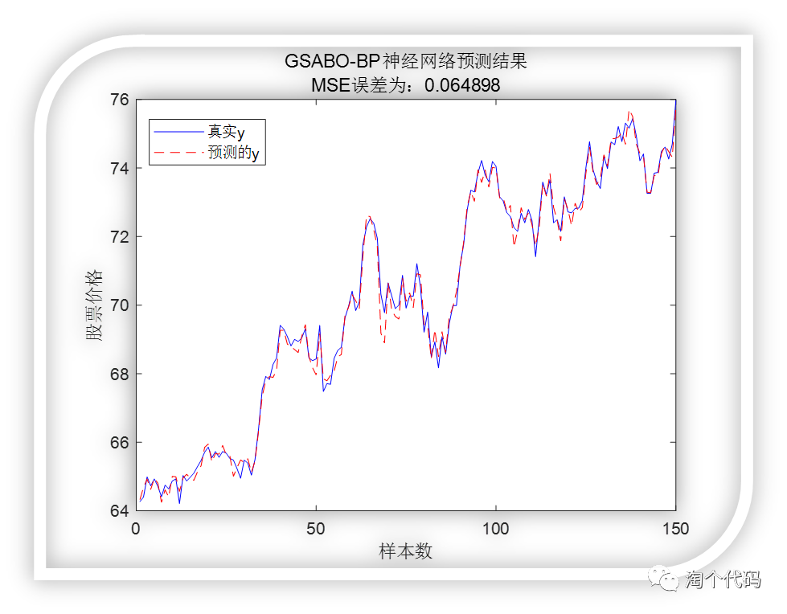
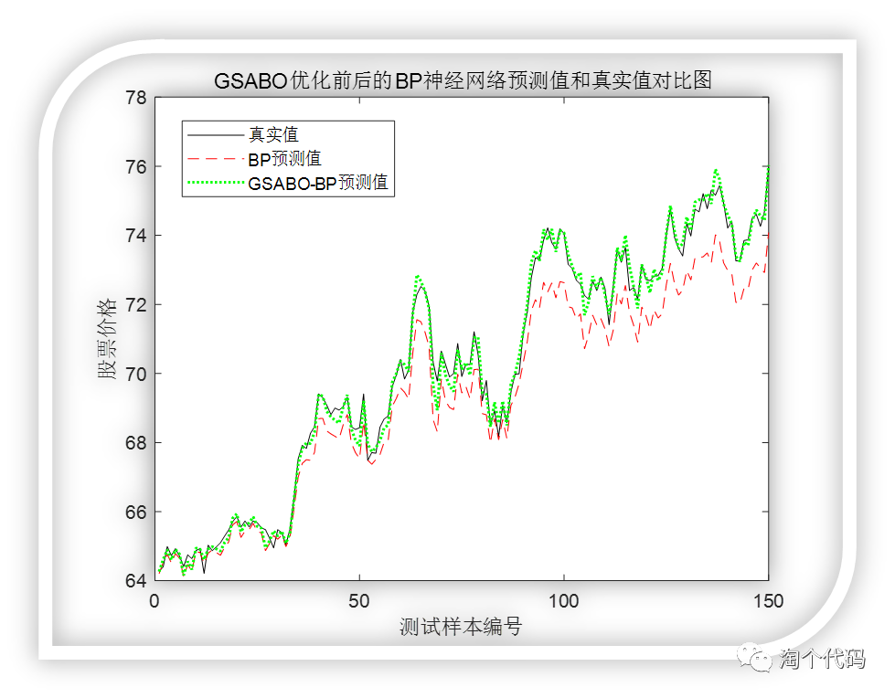
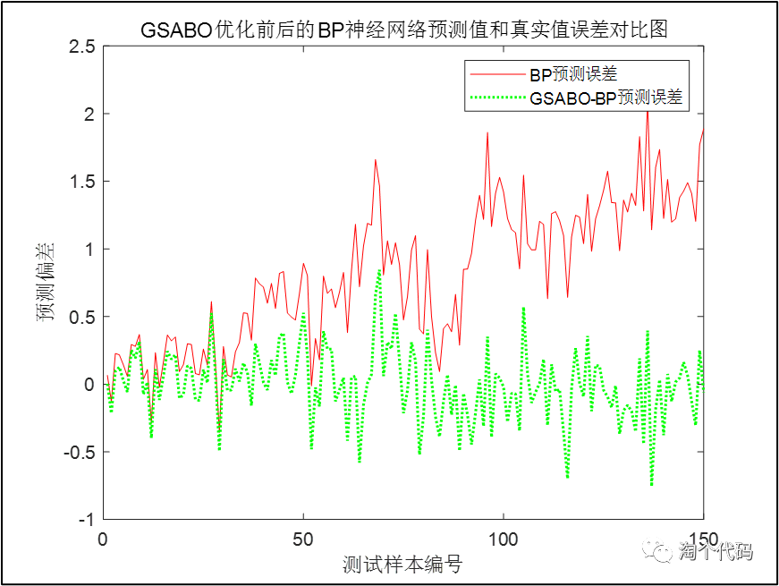
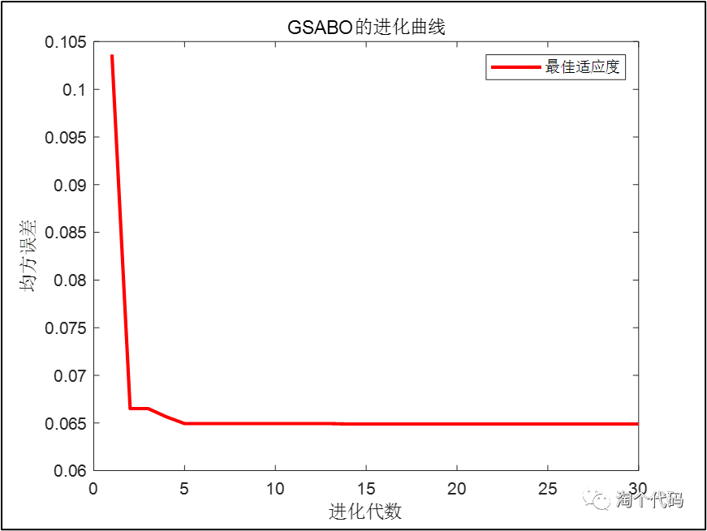
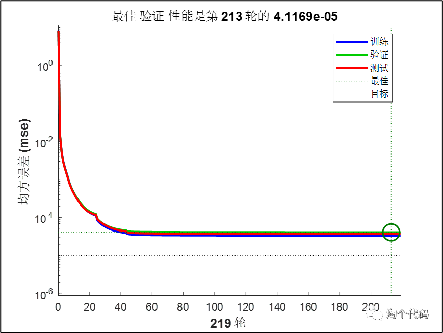
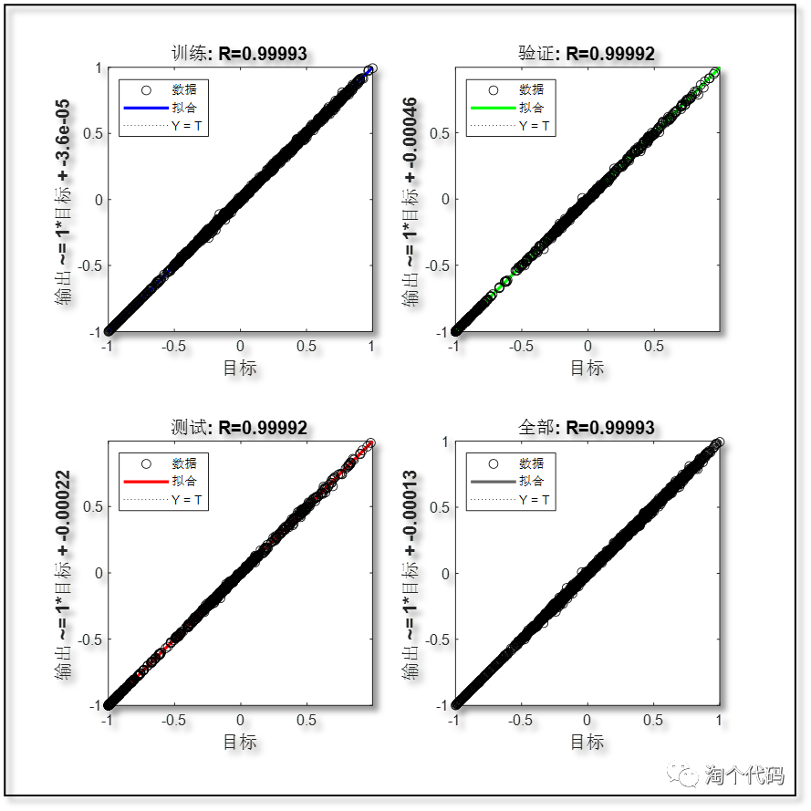
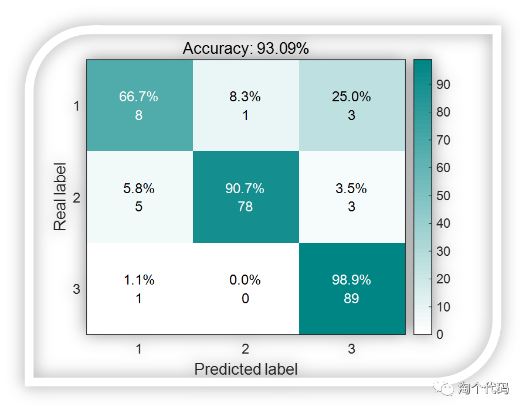
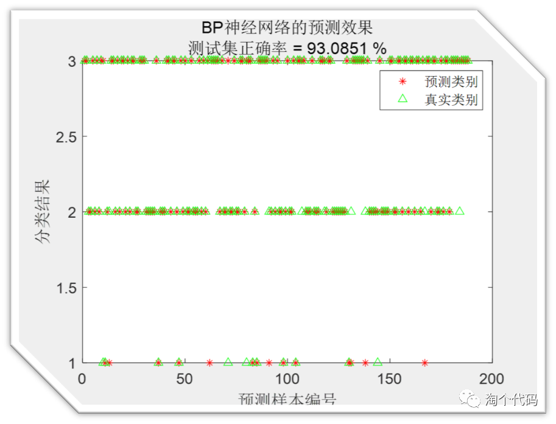
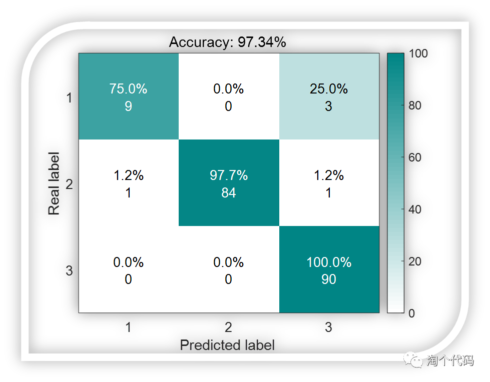
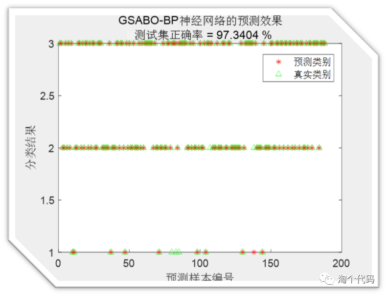
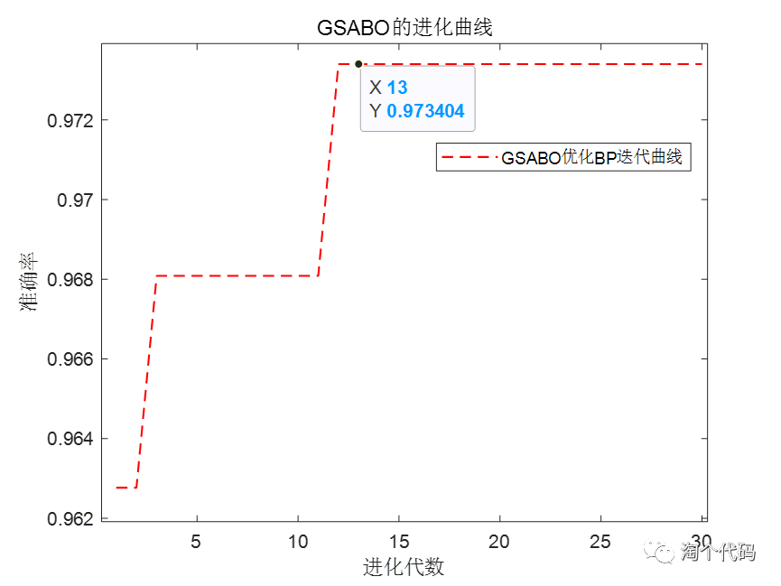

<!-- PAYMENT_BLOCK -->

## Get this dataset

- Payment link (Stripe): [Buy now](https://buy.stripe.com/3cs8yP7sY87d0vu9AB)
- Payment QR code: 

<!-- /PAYMENT_BLOCK -->
